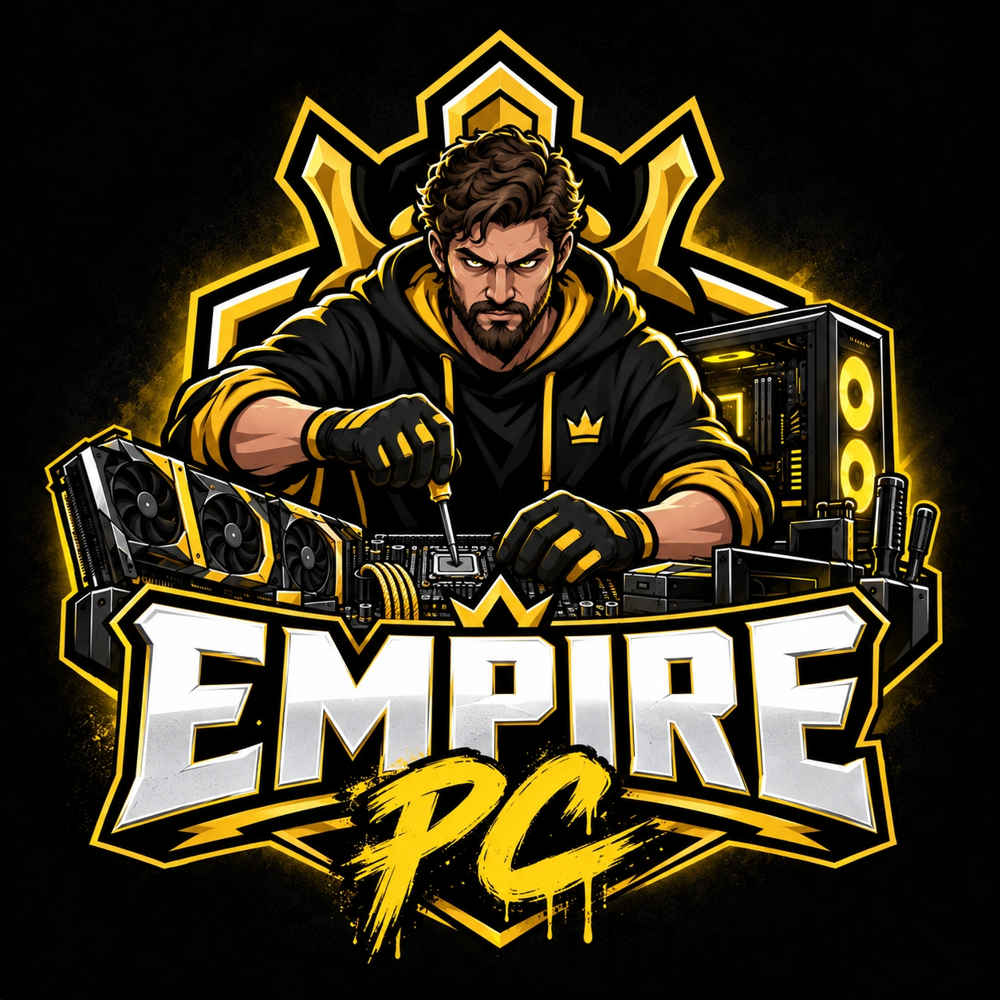

# Привет! 👋 Я Владислав

### Начинающий AI-разработчик | Студент Нетологии

Изучаю Python, искусственный интеллект и автоматизацию процессов. Люблю разбираться в технологиях, решать практические задачи и создавать полезные инструменты.

## 👨‍💻 Обо мне
- 🎓 Обучаюсь в Нетологии по программе «Специалист по искусственному интеллекту».
- 💻 Занимаюсь сборкой, настройкой и обслуживанием компьютеров.
- 🤖 Интересуюсь разработкой ИИ-агентов и автоматизацией бизнес-процессов.
- 🚀 Постепенно формирую портфолио собственных проектов.

## 🛠 Мои навыки
- **Python** — базовый уровень
- **Git и GitHub** — работа с репозиториями, ветками и Pull Requests
- **VS Code** — среда разработки
- **n8n** — автоматизация рабочих процессов
- **Компьютерное оборудование** — сборка, диагностика и настройка ПК

## 🎯 Мои интересы
1. Искусственный интеллект и машинное обучение
2. Разработка ИИ-агентов
3. Автоматизация рутинных задач
4. Программирование на Python
5. Компьютерные технологии

## 🚀 Мои проекты
### 🖥 Empire PC — сборка и обслуживание компьютеров
**Empire PC** — мой проект, посвящённый компьютерным технологиям.
Основные направления:
- 🔧 Сборка игровых и рабочих ПК на заказ
- ⚡ Модернизация и оптимизация компьютеров
- 🛠 Диагностика и техническое обслуживание
- 💻 Установка и настройка программного обеспечения

В рамках проекта занимаюсь подбором комплектующих, сборкой компьютеров и решением технических задач.

### 🔗 Сообщество Empire PC
- [ВКонтакте](https://vk.com/empirepc40)
- [Telegram](https://t.me/empire_pc40)

### 🖼 Логотип Empire PC

## 🔗 Ссылки
- [Мой GitHub](https://github.com/self2205)
- [Сайт Нетологии](https://netology.ru)

---

⭐ Продолжаю учиться, практиковаться и развиваться в AI-разработке!
